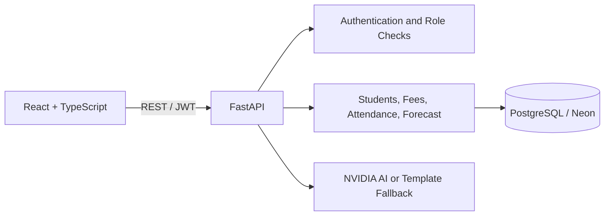

# TeachMan

**TeachMan** is a full-stack tuition-management platform that helps tutors run their teaching business and gives parents one place to manage their children's classes, fees, attendance, and learning progress.

Built for a hackathon demo, it combines role-based dashboards, financial operations, enrollment workflows, 30/60/90-day cash forecasting, and optional NVIDIA-powered AI explanations.

## Highlights

- Separate tutor and parent experiences with JWT-based role authorization
- Tutor operations for students, courses, batches, attendance, enrollments, invoices, payments, expenses, and notifications
- 30/60/90-day cash forecasting plus a read-only what-if simulator
- Parent overview of children, classes, fees, payment claims, attendance, milestones, and enrollments
- UPI payment claims that tutors can review and approve
- NVIDIA AI assistance with database-backed insights and a template fallback
- Responsive React interface with welcome, login, and registration animations
- Branded reload screen, route progress indicator, and manual reload control
- PostgreSQL/Neon storage with Alembic migrations

## Hackathon Demo

| Role | Phone | Password |
|---|---|---|
| Tutor | `9800000001` | `Demo@1234` |
| Parent | `9800000002` | `Demo@1234` |
| Parent | `9800000003` | `Demo@1234` |

After seeding, the tutor account includes sample students, courses, batches, invoices, payments, expenses, cash snapshots, and notifications. The parent accounts are linked to demo children.

## Screens and Workflows

### Tutor

1. Sign in or register a tuition business.
2. Add or update students, courses, and batches.
3. Create class sessions and mark student attendance.
4. Review enrollment requests and approve them to create an invoice.
5. Generate invoices, record payments, and review parent UPI claims.
6. Track expenses and opening cash.
7. View forecast risk, shortage dates, and cash-flow charts.
8. Use the what-if simulator or AI assistant to understand scenarios.

### Parent

1. Sign in or register a parent account.
2. View linked children and their dashboard summary.
3. Discover public tutors and batches.
4. Submit an enrollment request.
5. View invoices and outstanding fees.
6. Submit a UPI payment claim for tutor verification.
7. Check attendance and learning milestones.

## System Architecture



## Project Structure

```text
TeachMan/
├── frontend/
│   ├── src/
│   │   ├── components/       Shared UI, shell, logo, loading states
│   │   ├── lib/              API client and shared TypeScript types
│   │   └── pages/
│   │       ├── tutor/        Tutor dashboard and management pages
│   │       └── parent/       Parent dashboard and management pages
│   ├── public/images/        Welcome-page imagery
│   └── package.json
├── backend/
│   ├── app/
│   │   ├── api/routes/       FastAPI route modules
│   │   ├── core/             Settings and security
│   │   ├── db/               SQLAlchemy database setup
│   │   ├── models/           PostgreSQL models
│   │   ├── schemas/          Pydantic request and response models
│   │   └── services/         Enrollment, invoice, forecast, and AI logic
│   ├── migrations/           Alembic migrations
│   ├── tests/                API contract tests
│   ├── app/seed.py           Demo data generator
│   └── requirements.txt
├── render.yaml                Render blueprint
├── DEPLOYMENT.md              Production deployment guide
└── README.md
```

## Tech Stack

### Frontend

- React 18
- TypeScript
- Vite
- React Router
- Tailwind CSS
- Recharts
- Lucide icons
- React Hook Form and Zod

### Backend

- Python 3.11+
- FastAPI
- SQLAlchemy 2
- Alembic
- Pydantic 2
- JWT authentication
- Argon2 password hashing
- PostgreSQL/Neon
- NVIDIA OpenAI-compatible API

## Local Setup

### 1. Backend

Windows PowerShell:

```powershell
cd backend
python -m venv .venv
.\\.venv\\Scripts\\Activate.ps1
python -m pip install -r requirements.txt
copy .env.example .env
```

Set `DATABASE_URL`, `JWT_SECRET`, and `CORS_ORIGINS` in `backend/.env`. For optional AI features, set `NVIDIA_API_KEY`.

Run migrations and create demo data:

```powershell
python -m alembic upgrade head
python -m app.seed
python -m uvicorn app.main:app --reload --port 8000
```

The API and interactive Swagger documentation are available at:

- API health: `http://localhost:8000/api/health`
- Swagger UI: `http://localhost:8000/docs`

### 2. Frontend

Open a second terminal:

```powershell
cd frontend
npm install
npm run dev
```

Open `http://localhost:5173`.

For a frontend deployed on a different origin, copy `frontend/.env.example` to `frontend/.env.local` and set:

```env
VITE_API_BASE_URL=https://your-api-host
```

## Environment Variables

| Variable | Service | Purpose |
|---|---|---|
| `DATABASE_URL` | Backend | PostgreSQL connection string |
| `JWT_SECRET` | Backend | Long random secret for access tokens |
| `JWT_EXPIRE_MINUTES` | Backend | Access-token lifetime |
| `CORS_ORIGINS` | Backend | Allowed frontend origin(s), comma-separated |
| `NVIDIA_API_KEY` | Backend | Optional NVIDIA API key |
| `NVIDIA_BASE_URL` | Backend | NVIDIA API base URL |
| `NVIDIA_MODEL` | Backend | AI model used for explanations |
| `NVIDIA_MAX_TOKENS` | Backend | Maximum AI response tokens |
| `NVIDIA_REASONING_BUDGET` | Backend | AI reasoning token budget |
| `NVIDIA_ENABLE_THINKING` | Backend | Enables model thinking mode |
| `NVIDIA_TIMEOUT_SECONDS` | Backend | AI request timeout |
| `VITE_API_BASE_URL` | Frontend | Optional deployed API origin |

Never commit `.env`, database credentials, or API keys.

## Financial Data and Forecasting

- Money is stored as integer **paise** so calculations avoid floating-point currency errors.
- One rupee equals 100 paise.
- Opening cash is stored in the cash snapshot.
- 30/60/90-day forecasts estimate collections and expenses and identify projected shortages.
- The what-if simulator evaluates a scenario without changing the database.
- AI features explain available facts but do not perform financial calculations or modify records.

## API Overview

Major API route groups include:

- `/api/auth` — registration, login, logout, account, and password
- `/api/tutor` — tutor profile
- `/api/students` — student CRUD
- `/api/courses` — course CRUD
- `/api/batches` — batch CRUD and schedules
- `/api/enrollments` — enrollment requests and tutor decisions
- `/api/attendance` — class sessions and attendance
- `/api/invoices` — invoice creation and receipts
- `/api/payments` — payments and UPI claims
- `/api/expenses` — expense CRUD
- `/api/forecast` — forecast, cash snapshot, and simulation
- `/api/learning` — learning milestones
- `/api/parent` — parent dashboard and children
- `/api/notifications` — in-app notifications
- `/api/ai` and `/api/support` — AI assistance
- `/api/public` — public tutor and batch discovery

## Validation

Run backend contract tests:

```powershell
cd backend
.\\.venv\\Scripts\\python.exe -m unittest tests.test_api_contract
```

Build the frontend:

```powershell
cd frontend
npm run build
```

## Deployment

The repository includes a Render blueprint in `render.yaml` and detailed Neon/PostgreSQL and Render instructions in [DEPLOYMENT.md](DEPLOYMENT.md).

Production deployment uses:

- Render web service for the FastAPI backend
- Neon PostgreSQL for data
- Render static site for the React frontend
- `VITE_API_BASE_URL` or same-origin `/api` routing
- `CORS_ORIGINS` set to the deployed frontend URL

## Security Notes

- Passwords are hashed with Argon2.
- Protected routes require a signed JWT.
- Tutor and parent routes enforce role checks.
- Account deactivation preserves financial records.
- The support chat is session-only and does not store messages.
- API keys and database credentials must remain outside source control.
